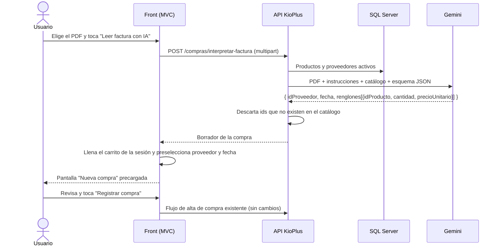

# Carga de compras desde una factura en PDF con IA

**Grupo N.º 6 – KioPlus**

**Integrantes:** Buffa Tomás, Busso Mateo y Cravero Agustín

Funcionalidad de negocio de KioPlus automatizada con inteligencia artificial:
el usuario sube la factura de un proveedor en PDF y el sistema precarga la
compra completa. El usuario la revisa y la confirma.

## 1. La idea

**Problema.** Para registrar una compra a un proveedor, el usuario tenía que
cargar a mano cada renglón de la factura: elegir el producto, escribir la
cantidad y el precio. Además, tenía que elegir el proveedor y la fecha. En una
factura de 20 renglones esto lleva tiempo y produce errores de tipeo.

**Solución.** En *Compras → Nueva compra* hay una opción nueva, **"Cargar desde
factura (PDF)"**. El usuario elige el PDF y la IA (Google Gemini) lo lee.
Con eso completa:

- los productos de la factura, buscados entre los productos del sistema,
- la cantidad y el precio unitario de cada uno,
- el proveedor,
- la fecha de la compra.

La compra **no se registra sola**. Queda precargada en pantalla y el usuario
la confirma con el botón **"Registrar compra"**, como siempre. Antes puede
quitar renglones, agregar otros o cambiar el proveedor o la fecha.

La IA **no completa fechas de vencimiento**, porque una factura no las informa.
Los renglones quedan como "No vence". Si hace falta un vencimiento, el usuario
puede cargar ese renglón a mano.

Corresponde a la opción 2 de la consigna: *agilizar o automatizar una
funcionalidad de negocio desde el punto de vista del usuario*.

## 2. Herramienta elegida

| Ítem | Detalle |
|------|---------|
| Servicio | API de Google Gemini (Google AI Studio), plan gratuito |
| Modelo | `gemini-3.5-flash` (configurable) |
| Entrada | El PDF completo, enviado en base64 dentro del pedido (`inline_data`) |
| Salida | JSON forzado con un esquema (`responseSchema`) |
| Librerías nuevas | Ninguna: se usa `HttpClient` de .NET |

Gemini lee PDFs de forma nativa, así que no hace falta una librería de OCR ni
extraer el texto antes.

**Por qué `gemini-3.5-flash` y no el modelo más nuevo (`gemini-3.8-flash`).**
Medimos los dos con la misma clave del plan gratuito. `gemini-3.8-flash` tardó
**73 segundos** en responder un simple "hola" y más de 120 segundos con una
factura. `gemini-3.5-flash` leyó la misma factura en **6,7 segundos**, con el
resultado correcto. Para una pantalla que el usuario está esperando, la
diferencia es decisiva. El modelo se cambia en `appsettings.json`
(`Gemini:Modelo`) sin tocar código.

## 3. Cómo funciona



### Decisiones de diseño

- **Se le pasa a la IA el catálogo del sistema.** El prompt incluye la lista de
  productos (id, nombre, marca) y de proveedores (id, razón social) activos.
  Así Gemini no solo lee "COCA COLA 500CC", sino que la asocia con el producto
  *Coca-Cola 500ml* del sistema y devuelve su id. Resuelve abreviaturas,
  mayúsculas y nombres escritos distinto.
- **Nunca se carga un producto inventado.** La API comprueba cada id que
  devuelve la IA contra el catálogo real. Si no existe, el renglón se informa
  como "no encontrado" y no entra al carrito. El usuario ve un aviso con esos
  renglones para darlos de alta o cargarlos a mano.
- **Respuesta con esquema obligatorio.** Se usa `responseMimeType:
  application/json` con un `responseSchema`, de modo que Gemini siempre
  responde con la misma estructura y el sistema la puede deserializar sin
  "limpiar" texto libre.
- **El flujo de confirmación no se tocó.** La IA solo llena el mismo carrito de
  sesión que usa la carga manual. Registrar la compra sigue pasando por el
  mismo código, que da de alta los lotes, mueve el stock y la caja y asocia el
  producto con el proveedor.
- **Reintento ante saturación.** En el plan gratuito Gemini a veces responde
  503 ("saturado") durante unos segundos. El cliente reintenta hasta 3 veces,
  esperando 2 s y después 4 s, antes de mostrarle el error al usuario.
- **La factura reemplaza la compra en curso.** Si había renglones cargados, se
  reemplazan por los de la factura.

## 4. Archivos

**API (`Clases-KioPlus_2026`)**

| Archivo | Qué hace |
|---------|----------|
| `Integraciones/GeminiCliente.cs` | Cliente HTTP de Gemini: arma el pedido, envía el PDF y traduce los errores (límite gratuito, clave inválida, sin conexión) a mensajes claros. |
| `Logica/LectorFacturaLogica.cs` | Arma el prompt con el catálogo, define el esquema JSON y valida los ids devueltos. |
| `Logica/ILectorFacturaLogica.cs` | Interfaz de la lógica. |
| `Logica/DTOs/FacturaDTOs.cs` | `FacturaInterpretadaDto` y `RenglonFacturaDto`. |
| `Endpoints/CompraEndpoints.cs` | Nuevo `POST /compras/interpretar-factura`. |
| `Program.cs` | Registra el cliente de Gemini (timeout de 90 s) y la lógica. |
| `appsettings.json` | `Gemini:Modelo`. |

**Front (`Front/KioPlusFront`)**

| Archivo | Qué hace |
|---------|----------|
| `Views/Compras/Nueva.cshtml` | Bloque "Cargar desde factura (PDF)" con el botón "Leer factura con IA". |
| `Controllers/ComprasController.cs` | Acción `CargarFactura`: llena el carrito y preselecciona proveedor y fecha. |
| `Services/LectorFacturaService.cs` | Sube el PDF a la API con un timeout propio de 120 s. |
| `Services/ApiClient.cs` | Nuevo `PostArchivoAsync` para enviar archivos (multipart). |
| `Models/Api/CompraModels.cs`, `Models/ViewModels/CompraViewModels.cs` | Modelos del borrador y de la compra sugerida. |
| `Views/Shared/_Mensajes.cshtml` | Nuevo aviso amarillo (`TempData["Aviso"]`) para lo que la IA no pudo cargar. |

## 5. Configuración

La clave de Gemini **no se guarda en el repositorio**. En desarrollo vive en
*user-secrets* de .NET, fuera de la carpeta del proyecto.

1. Obtener una clave gratuita en <https://aistudio.google.com> → **Claves de
   API** → **Crear clave de API**. Dejar el proyecto en **Nivel gratuito**.
2. Guardarla en la API:

   ```bash
   cd 2026/Clases-KioPlus_2026
   dotnet user-secrets set "Gemini:ApiKey" "TU_CLAVE"
   ```

3. Levantar la API y el front como siempre.

Si falta la clave, la pantalla muestra: *"Falta configurar la clave de Gemini
(Gemini:ApiKey) en la API."*

## 6. Cómo probarlo

1. Ir a **Compras → Nueva compra**.
2. En **Cargar desde factura (PDF)**, elegir una de las facturas de
   `docs/facturas-ejemplo/`.
3. Tocar **"Leer factura con IA"** y esperar unos segundos.
4. Revisar los renglones, el proveedor y la fecha precargados.
5. Tocar **"Registrar compra"**.

Las facturas de ejemplo son ficticias y fueron generadas para esta prueba.
Usan nombres escritos a propósito distinto de como están en el sistema, para
mostrar que la IA los asocia igual.

| Factura | Qué demuestra | Resultado obtenido |
|---------|---------------|--------------------|
| `factura-01-distribuidora-el-sol.pdf` | Abreviaturas ("FANTA NJA.", "AGUA VILLAVICENCIO S/GAS") | 4 de 4 productos reconocidos, en unos 6 s |
| `factura-02-golosinas-norte.pdf` | Proveedor escrito distinto ("S.R.L." en lugar de "SRL") y 6 renglones | Proveedor y 6 de 6 productos reconocidos, en unos 9 s |
| `factura-03-con-producto-nuevo.pdf` | Un producto que no existe en el sistema ("GALLETITAS OREO") | Carga 2 productos y avisa que las Oreo no existen, en unos 5 s |

### Datos que esperan las facturas

Para que las facturas coincidan, el sistema tiene que tener estos proveedores y
productos. Se pueden dar de alta desde las pantallas de Proveedores y Stock.
Los nombres no tienen que ser idénticos: la IA los asocia aunque estén
escritos distinto.

| Proveedores |
|-------------|
| Distribuidora El Sol S.A. |
| Mayorista Golosinas Norte SRL |

| Producto | Marca |
|----------|-------|
| Coca-Cola | Coca-Cola |
| Pepsi | Pepsi |
| Agua mineral sin gas 500ml | Villavicencio |
| Fanta naranja 500ml | Fanta |
| Alfajor triple chocolate | Jorgito |
| Chicle menta | Beldent |
| Chocolate con leche 25g | Milka |
| Caramelos masticables | Sugus |
| Papas fritas clásicas 85g | Lay's |
| Palitos salados 100g | Pehuamar |

## 7. Limitaciones

- **Plan gratuito.** Tiene un límite de pedidos por minuto y por día. Si se
  supera, se muestra: *"Se alcanzó el límite gratuito de Gemini. Esperá un
  minuto y volvé a intentar."*
- **Privacidad.** En el plan gratuito, Google puede usar el contenido enviado
  para mejorar sus modelos. Con facturas reales de un comercio habría que usar
  el plan pago.
- **Productos nuevos.** La IA no da de alta productos. Los renglones de
  productos que no existen en el sistema se avisan y se cargan a mano.
- **Revisión humana.** La IA puede equivocarse. Por eso la compra nunca se
  confirma sola.
